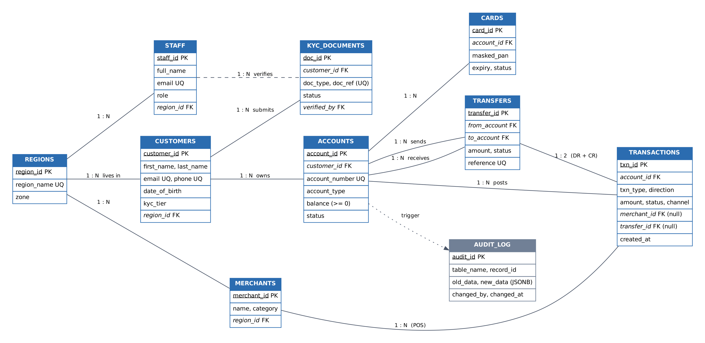

# Portfolio 1: Database Design and Modelling

**Case study:** PayNaija Wallet · **DBMS:** PostgreSQL 16 · **Course link:** Study Session 1 (stages of database design, ER model, normalisation)

## 1. Design process followed

The four stages of database design from Study Session 1 were applied in order:

| Stage | What was done for PayNaija |
|---|---|
| 1. Requirements analysis | Identified users (customers, support, compliance, admin), operations (transfer, statement, KYC, audit) and business rules (below) |
| 2. Conceptual design | ER diagram with 10 entities and their cardinalities (Figure 1) |
| 3. Logical design | ER mapped to relations; PK/FK chosen; normalised to 3NF/BCNF (Section 4) |
| 4. Physical design | Data types (`NUMERIC(15,2)` for money), CHECK/UNIQUE constraints, trigger, roles; indexes added in Portfolio 2 |

**Business rules captured as constraints**
- A customer must be 18 or older and have a unique email and a unique Nigerian phone number (`+234` + 10 digits).
- A customer may own many accounts; every account belongs to exactly one customer.
- A balance can never be negative (no overdraft on wallets).
- A transfer has exactly one sender and one receiver account, and they must be different.
- A transfer posts exactly two ledger rows: a debit (DR) and a credit (CR), giving double-entry book-keeping.
- KYC documents are verified by a staff member; a VERIFIED document must record who verified it and when.
- A customer who still has accounts cannot be deleted (protects financial history).
- Every balance change must be traceable (audit log, for NDPA 2023 and CBN audit requirements).

## 2. Entity-Relationship diagram



*Figure 1. ER diagram (source `erd.dot`, rendered with Graphviz). PK = primary key, FK = foreign key, UQ = unique.*

**Key relationships**
- `CUSTOMERS 1:N ACCOUNTS`, `CUSTOMERS 1:N KYC_DOCUMENTS`, `REGIONS 1:N CUSTOMERS`
- `ACCOUNTS 1:N TRANSACTIONS` (the ledger)
- **`ACCOUNTS M:N ACCOUNTS`** (an account can send to and receive from many accounts). This recursive many-to-many relationship is resolved by the associative entity **`TRANSFERS`**, which has two foreign keys to `ACCOUNTS` (`from_account`, `to_account`).
- `STAFF 1:N KYC_DOCUMENTS` (verifies), `MERCHANTS 1:N TRANSACTIONS` (optional; POS only)

## 3. Relational schema

```
REGIONS(region_id PK, region_name UQ, zone)
STAFF(staff_id PK, full_name, email UQ, role, region_id FK→REGIONS)
CUSTOMERS(customer_id PK, first_name, last_name, email UQ, phone UQ, date_of_birth, region_id FK→REGIONS, kyc_tier, created_at)
KYC_DOCUMENTS(doc_id PK, customer_id FK→CUSTOMERS, doc_type, doc_ref, status, verified_by FK→STAFF, verified_at)   UQ(doc_type, doc_ref)
ACCOUNTS(account_id PK, customer_id FK→CUSTOMERS, account_number UQ, account_type, balance, status, opened_at)
CARDS(card_id PK, account_id FK→ACCOUNTS, masked_pan, expiry, status)
MERCHANTS(merchant_id PK, name, category, region_id FK→REGIONS)
TRANSFERS(transfer_id PK, from_account FK→ACCOUNTS, to_account FK→ACCOUNTS, amount, status, reference UQ, created_at)
TRANSACTIONS(txn_id PK, account_id FK→ACCOUNTS, txn_type, direction, amount, status, merchant_id FK→MERCHANTS, transfer_id FK→TRANSFERS, channel, created_at)
AUDIT_LOG(audit_id PK, table_name, record_id, action, old_data JSONB, new_data JSONB, changed_by, changed_at)
```

Full DDL: [`sql/01_schema.sql`](sql/01_schema.sql). Selected design decisions:

| Decision | Reason |
|---|---|
| `NUMERIC(15,2)` for money, never `FLOAT` | Floating point cannot represent ₦0.10 exactly, and rounding errors are unacceptable in a ledger |
| Surrogate keys (`SERIAL`) plus natural keys kept `UNIQUE` (email, phone, account_number) | Stable, small join keys; business identifiers can change (e.g. a phone number) without cascading updates |
| `CHECK (balance >= 0)` | Enforces "no overdraft" inside the database, so no application bug can bypass it |
| `ON DELETE RESTRICT` on accounts→customers | Financial records must not disappear when a customer is deleted |
| `CHECK (from_account <> to_account)` | Prevents meaningless self-transfers |
| `masked_pan` stores only first 6 + last 4 digits | PCI-DSS and NDPA data minimisation: the database never stores full card numbers |
| `AFTER UPDATE` trigger writing to `audit_log` (JSONB old/new) | Accountability principle (NDPA 2023); shows who changed which balance and when |
| Roles `support_role` (read customer data only) and `compliance_role` (read everything); `audit_log` revoked from support | Least privilege / RBAC (Study Session 6) |

## 4. Normalisation

The starting point is the "customer statement" spreadsheet that the operations team used before the database existed (**UNF**):

| customer_id | name | phones | region | zone | accounts (repeating) → transactions (repeating) |
|---|---|---|---|---|---|
| 3 | Halima Adeyemi | 07000000003, 08031112222 | Lagos | South-West | 3000000003 WALLET ₦57,569 → {T1, 2026-09-12, ₦5,000, Merchant 7, Fuel}, {T2, …} ; 4000000003 SAVINGS … |

**UNF → 1NF (atomic values, no repeating groups).** Phones are split into single values, and the repeating account and transaction groups are flattened to one row per transaction:

`R1(customer_id, name, phone, region, zone, account_number, account_type, balance, txn_no, txn_date, amount, merchant_name, merchant_category)`, key = **(account_number, txn_no)**

Functional dependencies identified:
- FD1 `account_number → account_type, balance, customer_id`
- FD2 `customer_id → name, phone, region`
- FD3 `region → zone`
- FD4 `(account_number, txn_no) → txn_date, amount, merchant_name`
- FD5 `merchant_name → merchant_category`

*Anomalies in 1NF:* the balance is repeated on every transaction row (update anomaly); a new account cannot be stored until it has a transaction (insertion anomaly); deleting a customer's only transaction deletes the account (deletion anomaly).

**1NF → 2NF (remove partial dependencies).** FD1 depends on only *part* of the key (`account_number`), so those attributes move out:
- `ACCOUNT(account_number, account_type, balance, customer_id, name, phone, region, zone)`
- `TXN(account_number, txn_no, txn_date, amount, merchant_name, merchant_category)`

**2NF → 3NF (remove transitive dependencies).** In ACCOUNT, `account_number → customer_id → name, phone, region → zone` is transitive. In TXN, `… → merchant_name → merchant_category` is transitive. Splitting gives:
- `REGION(region_id, region_name, zone)`
- `CUSTOMER(customer_id, name, phone, region_id)`
- `ACCOUNT(account_number, account_type, balance, customer_id)`
- `MERCHANT(merchant_id, name, category)`
- `TRANSACTION(txn_id, account_id, date, amount, merchant_id)`

**BCNF check.** In every final table, every determinant is a candidate key (e.g. in CUSTOMERS both `email` and `phone` determine the row and are declared UNIQUE, so they are candidate keys). The schema is therefore in **BCNF**.

**Deliberate exception (justified denormalisation).** `accounts.balance` can be derived from the sum of the ledger, so storing it is technically redundant. It is kept because recomputing a balance from thousands of rows on every transfer would be too slow (physical design trade-off). Consistency is protected by updating the balance and the ledger in the **same ACID transaction** (Portfolio 3) and by the audit trigger.

## 5. Implementation and test evidence

**Data loaded** ([`sql/02_seed.sql`](sql/02_seed.sql); synthetic, reproducible with `setseed`, no real personal data):

```
       t       | count
---------------+--------
 regions       |      8
 customers     |   2000
 kyc_documents |   2000
 accounts      |   2987
 merchants     |     50
 cards         |   2000
 transactions  | 200000
```

**Constraint tests** ([`sql/03_constraint_tests.sql`](sql/03_constraint_tests.sql)). Every invalid operation is rejected by the DBMS:

```
--- Test 1: negative balance (CHECK balance >= 0)
ERROR:  new row for relation "accounts" violates check constraint "accounts_balance_check"
--- Test 2: duplicate email (UNIQUE)
ERROR:  duplicate key value violates unique constraint "customers_email_key"
--- Test 3: invalid Nigerian phone format (CHECK regex)
ERROR:  new row for relation "customers" violates check constraint "customers_phone_check"
--- Test 4: under-18 customer (CHECK date_of_birth)
ERROR:  new row for relation "customers" violates check constraint "customers_date_of_birth_check"
--- Test 5: account for non-existent customer (FOREIGN KEY)
ERROR:  insert or update on table "accounts" violates foreign key constraint "accounts_customer_id_fkey"
--- Test 6: transfer to the same account (CHECK from <> to)
ERROR:  new row for relation "transfers" violates check constraint "transfers_check"
--- Test 7: delete a customer who still has accounts (ON DELETE RESTRICT)
ERROR:  update or delete on table "customers" violates foreign key constraint "accounts_customer_id_fkey"
```
Full output: [`results/03_constraint_tests_output.txt`](results/03_constraint_tests_output.txt)

## 6. How to run
```bash
createdb paynaija
psql -d paynaija -f sql/01_schema.sql
psql -d paynaija -f sql/02_seed.sql
psql -d paynaija -f sql/03_constraint_tests.sql
```
