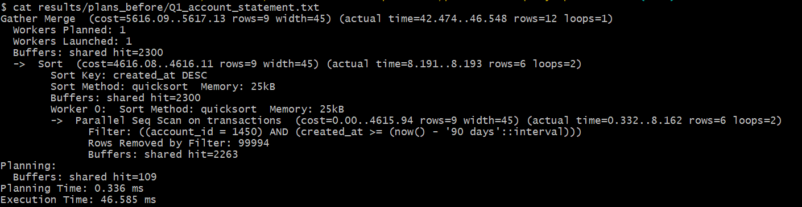
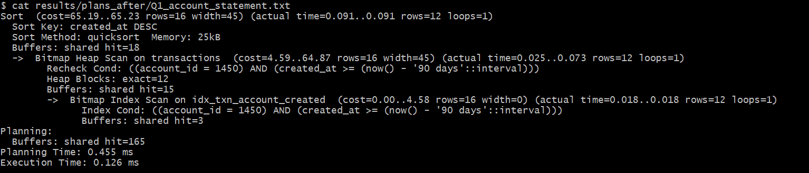
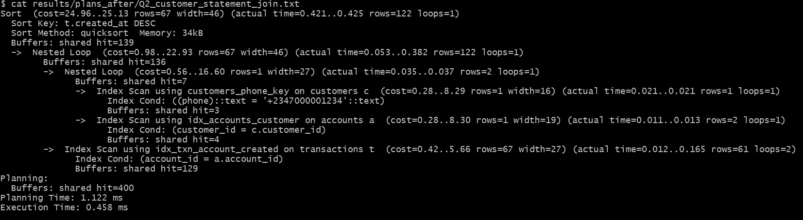

# Portfolio 2: Query Processing and Optimisation

**Case study:** PayNaija Wallet (200,000-row ledger) · **DBMS:** PostgreSQL 16 on Windows 11 (cost-based optimiser) · **Course link:** Study Session 4

## 1. Method

1. Wrote 7 business queries ([`sql/queries/`](sql/queries/)) that represent real PayNaija workloads, from simple OLTP lookups to OLAP-style reports.
2. **Baseline:** removed all optional indexes ([`sql/01_drop_indexes.sql`](sql/01_drop_indexes.sql)) and ran `ANALYZE` to refresh statistics. Each query was then run **5 times** with `EXPLAIN (ANALYZE, BUFFERS)`, keeping the **median** execution time ([`run_benchmark.sh`](run_benchmark.sh)). The median avoids distortion from the first "cold cache" run.
3. Read the BEFORE plans to find the bottleneck operator in each query.
4. **Optimised** with indexes chosen from those plans ([`sql/02_create_indexes.sql`](sql/02_create_indexes.sql)), a query rewrite (Q3) and a materialised view (Q4, [`sql/03_materialised_view.sql`](sql/03_materialised_view.sql)).
5. Re-ran the identical benchmark (AFTER) and compared the two. All plans are saved in `results/plans_before/` and `results/plans_after/`, and the raw timings in `results/timings_before.csv` and `results/timings_after.csv`.

## 2. Queries

| ID | Business purpose | SQL features |
|---|---|---|
| Q1 | Account statement, last 90 days (most frequent app call) | filter + range + ORDER BY |
| Q2 | Customer statement by phone number | 3-table JOIN |
| Q3 | Failed transactions on a given day (operations report) | function on column vs range predicate |
| Q4 | Monthly debit value per region (management report) | 4-table JOIN, GROUP BY, aggregation |
| Q5 | Top 3 spenders in each region | CTE + window function `rank() OVER (PARTITION BY …)` |
| Q6 | Fraud check: accounts with ≥3 failed attempts in 30 days | GROUP BY + HAVING |

## 3. Optimisations applied

```sql
-- Composite B+ tree: equality on account_id, then range + sort on created_at  (Q1, Q2)
CREATE INDEX idx_txn_account_created ON transactions (account_id, created_at DESC);
-- Partial covering index: only FAILED rows (~3%), so it is small and fast       (Q3, Q6)
CREATE INDEX idx_txn_failed_created ON transactions (created_at)
       INCLUDE (account_id, amount, channel) WHERE status = 'FAILED';
-- Foreign-key index (PostgreSQL does not create these automatically)          (Q2, Q5)
CREATE INDEX idx_accounts_customer ON accounts (customer_id);
```

| Index | Why this design |
|---|---|
| `idx_txn_account_created` | Column order matters: the **equality** column comes first (`account_id`), then the **range/sort** column. |
| `idx_txn_failed_created` | A **partial** index stores only the ~3% of rows that are FAILED, so it is much smaller than a full index. `INCLUDE` makes it **covering**, so Q6 can be answered from the index alone (Index Only Scan). |
| `idx_accounts_customer` | Lets the optimiser use an index nested-loop join from customers to accounts. |

**Query rewrite (Q3).** `WHERE created_at::date = CURRENT_DATE - 7` wraps the column in a function. The B+ tree is ordered by `created_at`, not by `created_at::date`, so the index cannot be used for the date condition: the predicate is not *sargable*. It was rewritten as the equivalent range `created_at >= CURRENT_DATE - 7 AND created_at < CURRENT_DATE - 6`.

**Materialised view (Q4).** The monthly/regional summary (104 rows) is pre-computed and refreshed nightly with `REFRESH MATERIALIZED VIEW CONCURRENTLY`.

## 4. Results (median of 5 runs, measured on my laptop)

| Query | Before (ms) | After (ms) | Plan change | Speed-up |
|---|---:|---:|---|---:|
| Q1 account statement | 45.05 | 0.12 | Parallel **Seq Scan** + Sort → **Bitmap Index Scan** on `idx_txn_account_created` | **≈ 366×** |
| Q2 customer statement (join) | 46.86 | 0.47 | Full scan of `transactions` → **Nested Loop** of three **Index Scans** | **≈ 99×** |
| Q3 original (function on column) | 47.43 | 5.65 | Partial index used for `status` only; date still filtered row by row | 8× |
| Q3 rewritten (range) | 48.32 | 0.16 | Both conditions resolved inside the partial index | **≈ 312×** |
| Q4 regional report (live) | 119.17 | 119.97 | **No change**: still a full scan + hash joins + aggregation | 1× |
| Q4b regional report (materialised view) | 119.17 | 0.13 | Scan of a 104-row pre-computed view | **≈ 931×** |
| Q5 top spenders (window) | 72.16 | 69.31 | **No real change**: reads most of the table either way | ≈ 1× |
| Q6 fraud velocity | 45.72 | 0.37 | Parallel Seq Scan → index scan on the partial index | **≈ 123×** |

### Evidence: Q1 execution plan before and after



```
BEFORE  (Execution Time: 46.585 ms)
Gather Merge  (cost=5616.09..5617.13 rows=9) (actual time=42.474..46.548 rows=12 loops=1)
  Workers Planned: 1   Workers Launched: 1
  ->  Sort  (actual time=8.191..8.193 rows=6 loops=2)   Sort Key: created_at DESC
        ->  Parallel Seq Scan on transactions  (cost=0.00..4615.94 rows=9) (actual time=0.332..8.162 rows=6 loops=2)
              Filter: ((account_id = 1450) AND (created_at >= (now() - '90 days'::interval)))
              Rows Removed by Filter: 99994
              Buffers: shared hit=2263
```



```
AFTER   (Execution Time: 0.126 ms)
Sort  (cost=65.19..65.23 rows=16) (actual time=0.091..0.091 rows=12 loops=1)
  Buffers: shared hit=18
  ->  Bitmap Heap Scan on transactions  (cost=4.59..64.87 rows=16) (actual time=0.025..0.073 rows=12)
        Heap Blocks: exact=12
        ->  Bitmap Index Scan on idx_txn_account_created  (cost=0.00..4.58 rows=16) (actual time=0.018..0.018 rows=12)
              Index Cond: ((account_id = 1450) AND (created_at >= (now() - '90 days'::interval)))
```

The optimiser's estimated cost fell from **5,617 to 65 units**, and the pages read fell from **2,300 to 18** buffers. The planner estimated 16 matching rows and the actual number was 12, which shows the table statistics were accurate.

### Evidence: Q2, the optimiser changed the join algorithm



```
AFTER  (Execution Time: 0.458 ms)
Sort  (cost=24.96..25.13 rows=67) (actual rows=122)
  ->  Nested Loop  (actual rows=122)
        ->  Nested Loop  (actual rows=2)
              ->  Index Scan using customers_phone_key on customers c        (actual rows=1)
              ->  Index Scan using idx_accounts_customer on accounts a       (actual rows=2)
        ->  Index Scan using idx_txn_account_created on transactions t       (actual rows=61 loops=2)
```

The query finds **1 customer** by phone (unique index), then that customer's **2 accounts** (FK index), then **61 transactions per account** (composite index). The whole statement touched only 139 buffers.

### The cost of indexes (write overhead)

[`sql/04_index_write_cost.sql`](sql/04_index_write_cost.sql) inserts 50,000 ledger rows inside a rolled-back transaction (so no data is kept), 3 runs each:

| Scenario | Run 1 | Run 2 | Run 3 | Median |
|---|---:|---:|---:|---:|
| With the 2 extra transaction indexes | 471.7 ms | 471.1 ms | 567.9 ms | **471.7 ms** |
| Without them | 357.6 ms | 364.9 ms | 391.8 ms | **364.9 ms** |

Inserts were **about 29% slower** with the indexes, because every new row must also be added to each B+ tree.

## 5. Analysis

**Why the OLTP queries improved.** PostgreSQL uses **cost-based optimisation (CBO)**: it estimates the cost of alternative plans from table statistics collected by `ANALYZE` and picks the cheapest. Before indexing, the only way to find one account's transactions was a full sequential scan, so Q1 examined 200,000 rows (99,994 removed by the filter in each of two processes) to return 12. With the composite index, the optimiser predicted a highly **selective** result (16 rows) and switched to an index scan costing 65 units instead of 5,617. In Q2 the cheaper access paths also changed the **join strategy**: with an index on every join column, a **nested-loop join** became cheapest, because each step starts from a tiny input (1 customer → 2 accounts) and uses an index to find the matching rows.

**An observation from my Windows environment.** In the Q1 BEFORE plan, the scan and sort inside the parallel worker finished in about **8 ms**, but the top `Gather Merge` node only finished at **46.5 ms**. Most of the baseline time (around 38 ms) was the overhead of **launching a parallel worker**. PostgreSQL on Windows has to start a new process for each worker, which is more expensive than on Linux. This is why my baseline times (about 45 ms) are higher than results reported on Linux for the same data, while my indexed times (about 0.1 ms) are almost identical. **Index lookups are far less sensitive to the platform than full scans**, so the benefit of indexing was even larger on my machine (366× for Q1).

**Heuristics from the course seen in practice.** The planner applied **selection push-down** (filters evaluated inside the scan node, never after a join), **projection** (only the needed columns move up the plan), and joins instead of Cartesian products, all automatically.

**Why Q4 and Q5 did not improve, and why that is correct.** These are **OLAP** queries that need most of the 200,000 rows (very low selectivity). Fetching that many rows through an index would cost more random I/O than one sequential pass, so the CBO correctly ignored the new indexes. This matches the course point that row-store RDBMS are optimised for OLTP rather than analytics. The right tool was **pre-aggregation**: the materialised view answered the Q4 report in 0.13 ms (≈ 931× faster). Its trade-off is **staleness**: the data is only as fresh as the last refresh. That is acceptable for a management report but never for balances. A larger PayNaija would move such reports to a data warehouse (Session 3).

**Sargability.** Q3 showed that even when the right index exists, wrapping the indexed column in a function (`created_at::date`) stops the index being used for that condition (5.65 ms). Rewriting it as a range predicate made the same query **36× faster again** (0.16 ms), with no new index needed.

**Trade-offs.** Indexes are not free: inserts were about 29% slower, and every index uses extra disk space and must be maintained. PayNaija's workload is read-heavy for statements and fraud checks, so the trade is worthwhile. Only three targeted indexes were created rather than indexing every column, and the fraud index is partial, so it stays small.

## 6. How to run
```bash
psql -d paynaija -f sql/01_drop_indexes.sql && bash run_benchmark.sh before
psql -d paynaija -f sql/02_create_indexes.sql && psql -d paynaija -f sql/03_materialised_view.sql && bash run_benchmark.sh after
psql -d paynaija -f sql/04_index_write_cost.sql
```
(Q4b reports an error in the BEFORE run because the materialised view does not exist yet. This is expected.)
