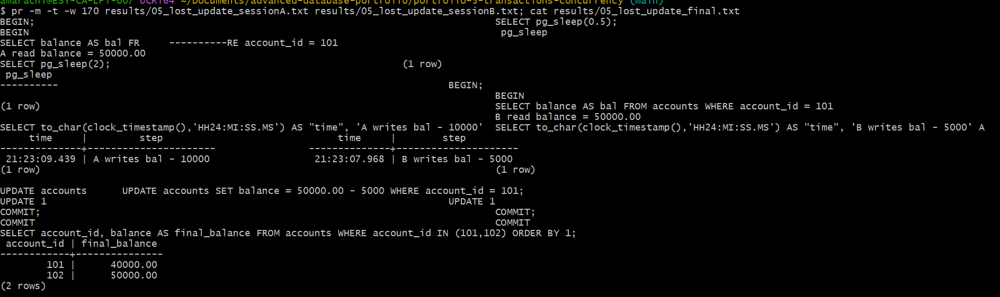
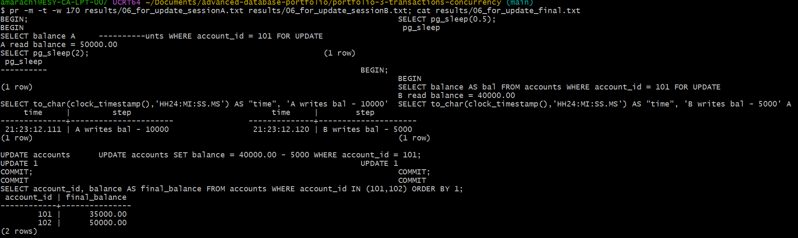
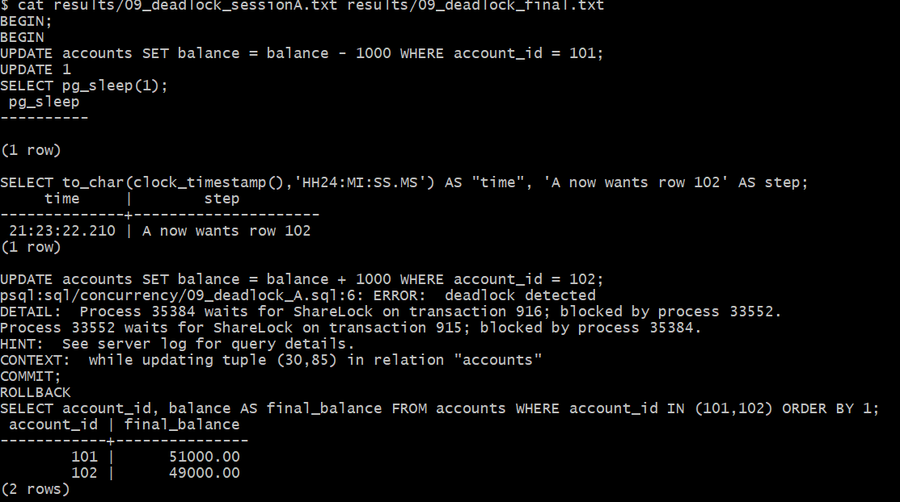
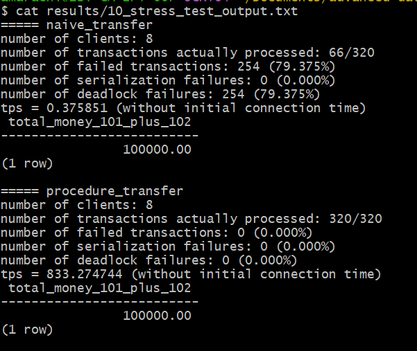
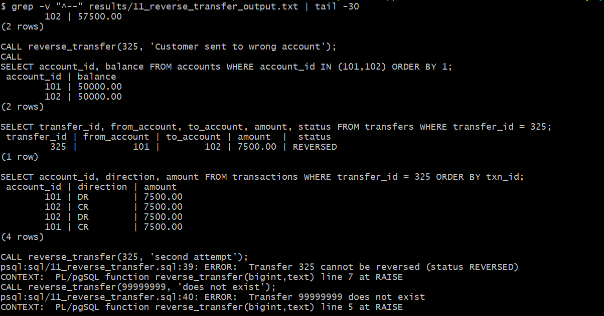
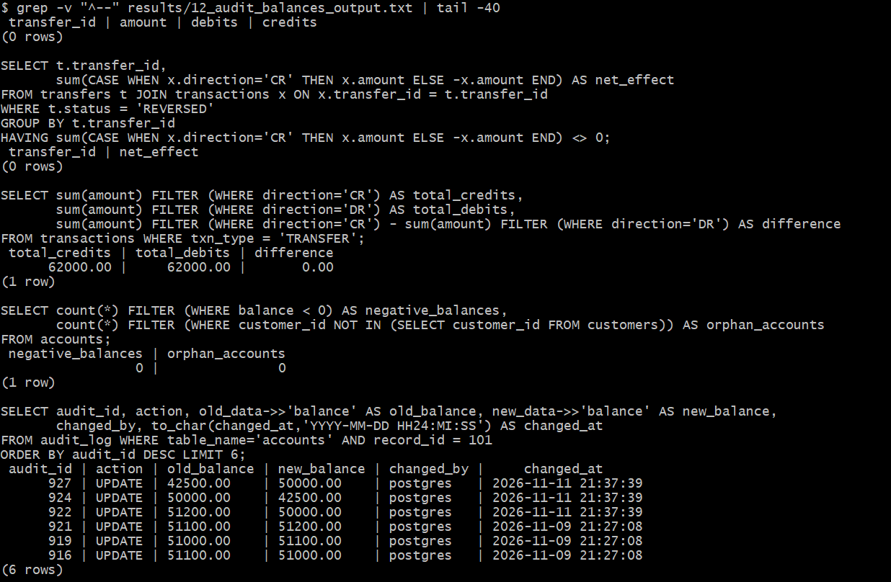

# Portfolio 3: Transactions and Concurrency

**Case study:** PayNaija Wallet fund transfers · **DBMS:** PostgreSQL 16 on Windows 11 (MVCC, default isolation READ COMMITTED) · **Course link:** ACID / BASE (Study Session 2), concurrency and locking issues (Session 1)

All demos use accounts **101** and **102**, reset to ₦50,000 each before every demo. Concurrency demos run **two real database sessions at the same time** (Session A and Session B) using [`run_concurrent.sh`](run_concurrent.sh); timestamps come from `clock_timestamp()`.

## Part A: Transaction control (single session)

### Demo 1: COMMIT: successful ₦10,000 transfer ([`sql/01_commit_transfer.sql`](sql/01_commit_transfer.sql))
Four statements (transfer record, debit, credit, two ledger rows) run as **one atomic unit**.
```
COMMIT
 account_id | balance
        101 | 40000.00
        102 | 60000.00
audit_log (latest 2 rows):
 record_id 102 | old {"balance": 50000.00} | new {"balance": 60000.00}
 record_id 101 | old {"balance": 50000.00} | new {"balance": 40000.00}
```
Full output: `results/01_commit_transfer_output.txt`
The audit trigger from Portfolio 1 recorded both balance changes inside the same transaction.

### Demo 2: ROLLBACK: insufficient funds ([`sql/02_rollback_insufficient_funds.sql`](sql/02_rollback_insufficient_funds.sql))
Transfer ₦100,000 when account 101 holds only ₦40,000. The **credit to 102 runs first and succeeds**, then the debit violates `CHECK (balance >= 0)`:
```
UPDATE accounts SET balance = balance + 100000 WHERE account_id = 102;   -> UPDATE 1
UPDATE accounts SET balance = balance - 100000 WHERE account_id = 101;
ERROR:  new row for relation "accounts" violates check constraint "accounts_balance_check"
COMMIT;   -> ROLLBACK
 account_id | balance
        101 | 40000.00      <- unchanged
        102 | 60000.00      <- the ₦100,000 credit was undone
```
**Atomicity:** PostgreSQL refused to commit a half-finished transfer, so no money was created. **Consistency:** the constraint guaranteed the database moved only between valid states.

### Demo 3: SAVEPOINT (partial rollback) ([`sql/03_savepoint.sql`](sql/03_savepoint.sql))
A ₦2,000 transfer succeeds, but posting an optional ₦50 fee fails (FK error). `ROLLBACK TO SAVEPOINT before_fee` undoes only the fee, and the transfer commits: 101 = ₦38,000, 102 = ₦62,000.

### Demo 4: Stored procedure `transfer_funds()` ([`sql/04_transfer_procedure.sql`](sql/04_transfer_procedure.sql))
Production version used by the rest of the portfolio. It (1) locks both account rows with `SELECT … FOR UPDATE` **in ascending account_id order**, (2) validates status and funds, (3) writes the transfer and both ledger entries.
```
CALL transfer_funds(101, 102, 5000);      -> CALL
CALL transfer_funds(101, 102, 9000000);
ERROR:  Insufficient funds: balance 33000.00, requested 9000000
```

## Part B: Concurrency problems and control mechanisms (two sessions)

### Demo 5: The problem: LOST UPDATE ([`sql/concurrency/05_lost_update_A.sql`](sql/concurrency/05_lost_update_A.sql) / `_B.sql`)
Two app servers withdraw from account 101 (₦50,000) at the same time using read-then-write logic with no lock.

| Time | Session A (withdraw ₦10,000) | Session B (withdraw ₦5,000) |
|---|---|---|
| t = 0 s | `BEGIN`; reads balance = **50,000** | |
| t = 0.5 s | (busy: fraud check / network call) | `BEGIN`; reads balance = **50,000** |
| t ≈ 0.5 s | | writes 50,000 − 5,000 = **45,000**; `COMMIT` |
| t ≈ 2 s | writes 50,000 − 10,000 = **40,000**; `COMMIT` (overwrites B) | |



```
 account_id | final_balance
        101 |      40000.00        <- should be 35,000. B's ₦5,000 withdrawal was LOST
```
The customer received ₦15,000 but was charged only ₦10,000. Both transactions committed with no error, which is why this anomaly is dangerous.

### Demo 6: Fix 1: pessimistic locking with `SELECT … FOR UPDATE`
Same scripts, but the read takes a row-level **exclusive lock**:
```
Session A:  SELECT balance ... FOR UPDATE   -> 50000.00   ... writes 40000, COMMIT
Session B:  SELECT balance ... FOR UPDATE   -> BLOCKED until A commits, then reads 40000.00
            writes 40000 - 5000, COMMIT
 account_id | final_balance
        101 |      35000.00        <- correct
```



B waited about 1.5 s and then saw A's committed value. The two transactions were serialised, as in **two-phase locking (2PL)**: locks are held until commit.

### Demo 7: Fix 2: REPEATABLE READ isolation (optimistic)
A updates 101 and holds its transaction open; B (REPEATABLE READ) reads 50,000 from its snapshot and then tries to update the same row:
```
Session B: UPDATE accounts SET balance = balance - 5000 WHERE account_id = 101;
ERROR:  could not serialize access due to concurrent update        (SQLSTATE 40001)
B: application catches SQLSTATE 40001 and RETRIES the whole transaction:
UPDATE 1 / COMMIT
 final_balance = 35000.00                                            <- correct
```
Instead of blocking, the database **detects** the conflict and forces B to retry with fresh data. This is how MVCC databases avoid lost updates without read locks.

### Demo 8: Isolation levels: non-repeatable read
Session A reads account 101 twice, 2 s apart; Session B commits a ₦1,000 withdrawal in between.

| Isolation level of A | First read | Second read | Anomaly? |
|---|---:|---:|---|
| READ COMMITTED (PostgreSQL default) | 50,000.00 | **49,000.00** | **Yes**: non-repeatable read |
| REPEATABLE READ | 50,000.00 | **50,000.00** | No: A keeps its snapshot |

### Demo 9: Deadlock ([`sql/concurrency/09_deadlock_A.sql`](sql/concurrency/09_deadlock_A.sql) / `_B.sql`)
A transfers 101→102 (locks 101, then wants 102); B transfers 102→101 (locks 102, then wants 101).
```
Session A: UPDATE accounts ... WHERE account_id = 102;
ERROR:  deadlock detected
DETAIL:  Process 35384 waits for ShareLock on transaction 916; blocked by process 33552.
         Process 33552 waits for ShareLock on transaction 915; blocked by process 35384.
COMMIT; -> ROLLBACK          (A is chosen as the victim)
Session B: UPDATE 1 / COMMIT (B completes)
 account_id 101 final_balance = 51000.00   <- only B's 102 -> 101 transfer of N1,000 survived
```


After `deadlock_timeout` (1 s), PostgreSQL's deadlock detector found the cycle in the **wait-for graph** and aborted one transaction so the other could finish.

### Demo 10: Load test: deadlock prevention at scale ([`run_stress_test.sh`](run_stress_test.sh))
`pgbench`, **8 concurrent clients × 40 transfers**, random direction between 101 and 102:

| Implementation | Processed | Deadlock failures | Throughput | Money conserved (101 + 102) |
|---|---:|---:|---:|---|
| Naive: lock rows in transfer order | 66 / 320 | **254 (79.4%)** | 0.38 tps | ₦100,000 ✔ |
| `transfer_funds()`: lock rows in **ascending id order** | 320 / 320 | **0 (0%)** | **833.3 tps** | ₦100,000 ✔ |



## Analysis

| Isolation level | Dirty read | Non-repeatable read | Phantom | Lost update | In PostgreSQL |
|---|---|---|---|---|---|
| Read Uncommitted | possible* | possible | possible | possible | treated as Read Committed |
| **Read Committed** (default) | prevented | **possible (Demo 8)** | possible | **possible (Demo 5)** | |
| **Repeatable Read** | prevented | **prevented (Demo 8)** | prevented in PG | **detected (Demo 7)** | snapshot isolation |
| Serializable | prevented | prevented | prevented | prevented | SSI, may abort with 40001 |

\*PostgreSQL never allows dirty reads, because of MVCC.

- **ACID in practice.** Demo 2 showed *atomicity* (all-or-nothing), the CHECK constraint enforced *consistency*, Demos 5–8 tested *isolation*, and the committed transfer survived the crash and failover in Portfolio 5 (*durability*, via the write-ahead log).
- **Pessimistic vs optimistic control.** `FOR UPDATE` (Demo 6) makes the second transaction **wait**; REPEATABLE READ (Demo 7) lets it proceed and **aborts** it on conflict, so the application must retry. For a hot wallet account that is updated very often, pessimistic locking avoids repeated retries. For rarely-conflicting updates, optimistic control gives higher concurrency.
- **Deadlocks are a design problem, not a database bug.** The detector *resolves* deadlocks, but each one costs a 1-second wait plus a failed customer transfer: throughput fell to 0.38 tps and 79% of transfers failed. Enforcing a **global lock order** (always lock the lower account_id first) *prevents* the circular wait, which is one of the four Coffman conditions for deadlock. The result was zero deadlocks and about 2,200× higher throughput (833 vs 0.38 tps), with the same money-conservation guarantee.
- **Choice for PayNaija:** keep READ COMMITTED (fast) as the default, and make every money movement go through `transfer_funds()`, which takes explicit row locks in a fixed order. Use SERIALIZABLE with retry for complex compliance batch jobs.

## How to run
```bash
psql -d paynaija -f sql/00_setup_demo_accounts.sql
for f in 01_commit_transfer 02_rollback_insufficient_funds 03_savepoint 04_transfer_procedure; do psql -d paynaija -e -f sql/$f.sql; done
for d in 05_lost_update 06_for_update 07_repeatable_read 08_nonrepeatable_read_committed 08_nonrepeatable_repeatable_read 09_deadlock; do bash run_concurrent.sh $d; done
bash run_stress_test.sh | tee results/10_stress_test_output.txt
```
Session outputs: `results/<demo>_sessionA.txt`, `results/<demo>_sessionB.txt`, `results/<demo>_final.txt`.

## Part C: Fintech operations required by the case study

### Demo 11: Reverse a completed transfer ([`sql/11_reverse_transfer.sql`](sql/11_reverse_transfer.sql))
A committed transaction can never be "un-committed" (**durability**), so a disputed or mistaken transfer is reversed with a new **compensating transaction**. The stored procedure `reverse_transfer()` locks the transfer row and both accounts (lowest account_id first, the same deadlock-prevention rule as `transfer_funds()`), checks that the recipient still has the funds, moves the money back, posts two new ledger rows, marks the transfer `REVERSED` and writes the reason to the audit log.



The full history is kept (original transfer + reversal) rather than deleting rows, which is what auditors and regulators expect. Note that a transfer that *fails* part-way never needs reversing: atomicity (Demo 2) guarantees it leaves no trace.

### Demo 12: Audit account balances ([`sql/12_audit_balances.sql`](sql/12_audit_balances.sql))
Five double-entry consistency checks. Checks 1–2 should return no rows, check 3 a zero difference, and check 4 zero counts.

| Check | What it verifies | My result |
|---|---|---|
| 1 | Every SUCCESS transfer has exactly one DR and one CR of equal amount | **0 rows** (no violations) |
| 2 | Every REVERSED transfer nets to zero | **0 rows** |
| 3 | Transfers move money but never create or destroy it | credits ₦62,000.00 = debits ₦62,000.00, **difference 0.00** |
| 4 | No negative balances, no orphaned accounts | **0 / 0** |
| 5 | Audit trail of every balance change on account 101 (who, when, old → new) | shown below |



The ₦62,000 total matches the transfers made in this portfolio: 320 load-test transfers × ₦100 (₦32,000) + Demo 1 (₦10,000) + Demo 4 (₦5,000) + the ₦7,500 transfer and its reversal (₦15,000). The CHECK constraints, the trigger-based audit log and the ACID transactions together keep the ledger provably consistent even after hundreds of concurrent transfers.
