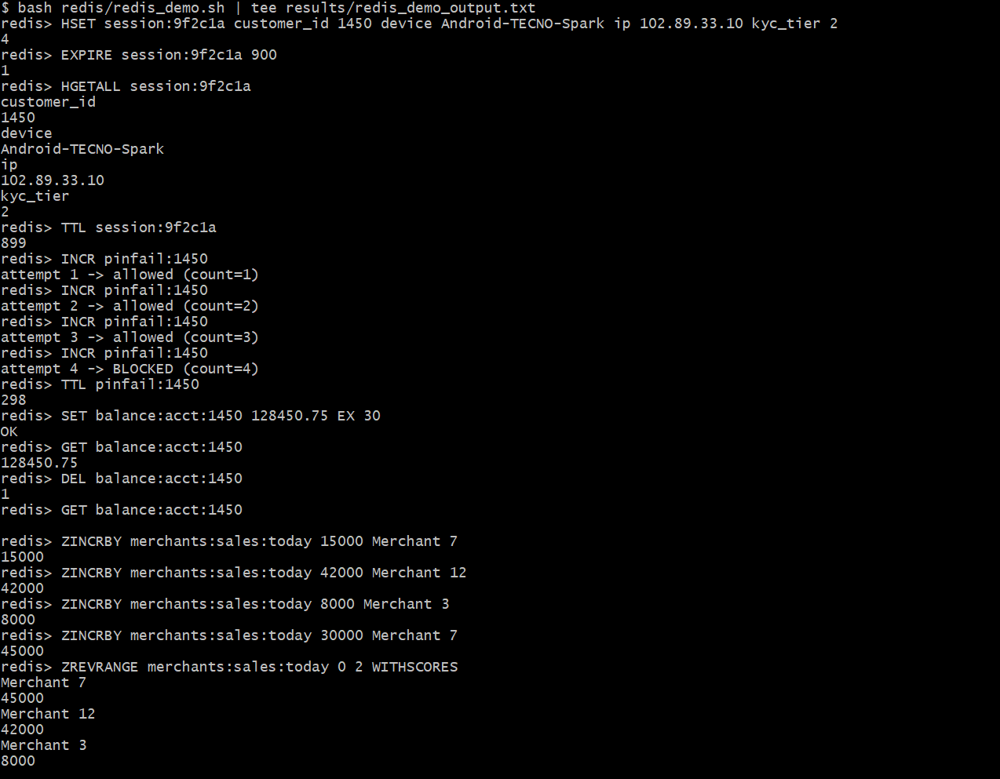
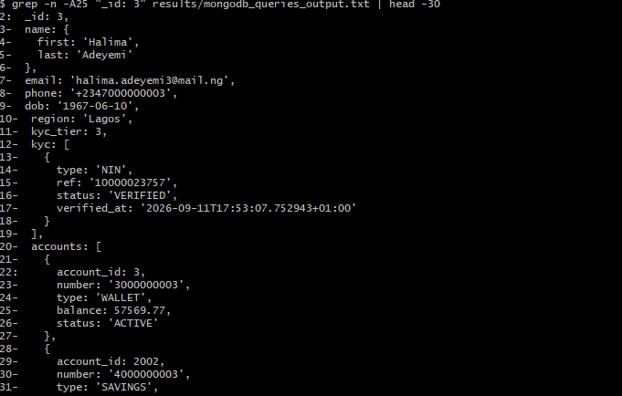
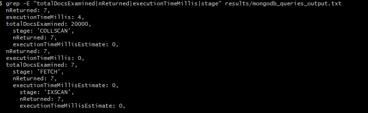
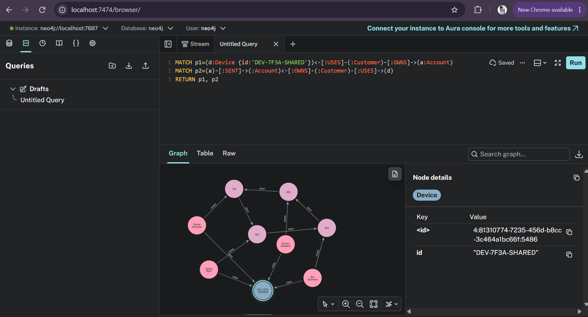
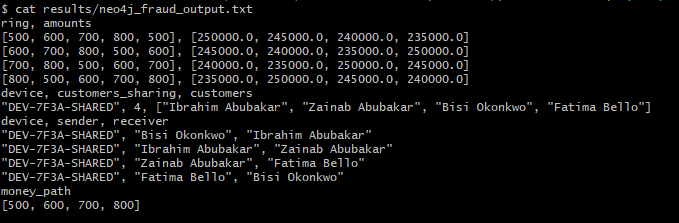

# Portfolio 4: NoSQL and Advanced Data Models

**Case study:** the same PayNaija Wallet data, modelled in three NoSQL families · **Environment:** Windows 11, Docker Desktop (Redis 7, MongoDB 7, Neo4j 5 containers) · **Course link:** Session 1 (NoSQL types, NoSQL vs NewSQL), Session 5 (graph databases and knowledge graphs)

PayNaija keeps **money** in PostgreSQL, because balances need ACID (Portfolios 1–3). Three parts of the workload fit the relational model poorly, and each is moved to the NoSQL model that suits it (**polyglot persistence**):

| Workload | Problem in the relational model | NoSQL model chosen |
|---|---|---|
| Sessions, PIN brute-force limits, balance cache, live leaderboards | Very high read/write rate; short-lived data that should expire automatically | **Key-value**: Redis |
| Customer profile + KYC + devices + preferences | Semi-structured; fields differ between customers and change often; needs 4–5 joins to assemble one profile | **Document**: MongoDB |
| Fraud and anti-money-laundering investigation | Questions are about *relationships* (rings, shared devices, money paths), which need recursive self-joins in SQL | **Graph**: Neo4j |

All three databases ran as Docker containers on my laptop. The MongoDB and Neo4j data was **exported from my own Portfolio 1–3 PostgreSQL database** using [`export_from_postgres.sh`](export_from_postgres.sh), so every model describes the same customers, accounts and transfers.

---

## A. Key-value model: Redis

Script: [`redis/redis_demo.sh`](redis/redis_demo.sh) · Output: [`results/redis_demo_output.txt`](results/redis_demo_output.txt)

| Key pattern | Redis type | Purpose | Expiry |
|---|---|---|---|
| `session:<token>` | Hash | Logged-in session (customer, device, IP, KYC tier) | 900 s (auto logout) |
| `pinfail:<customer_id>` | String counter | Brute-force protection: max 3 wrong PINs per 5 min | 300 s |
| `balance:acct:<id>` | String | Cache-aside copy of balance for the app home screen | 30 s, deleted on every transfer |
| `merchants:sales:today` | Sorted set | Real-time merchant leaderboard | daily |



Results: the session expired automatically after its 900-second TTL; PIN attempts 1–3 were allowed and **attempt 4 was BLOCKED**; the cached balance returned `(nil)` once it was invalidated after a transfer; and the sorted set ranked **Merchant 7 (₦45,000)** first.

**Why it suits the workload.** Every operation is a single O(1) or O(log n) lookup by key, held in memory with sub-millisecond latency. TTL gives automatic expiry, which would need a scheduled cleanup job in SQL. `INCR` is **atomic**, so two simultaneous wrong-PIN attempts cannot both slip through, which matters from a security point of view. Redis gives no joins, no ad-hoc queries and limited durability, so it is used only for data that can be rebuilt. **Balances are never stored only in Redis.**

---

## B. Document model: MongoDB

Files: [`mongodb/customers.json`](mongodb/customers.json) (2,000 documents), [`mongodb/transactions.json`](mongodb/transactions.json) (20,000 documents), [`mongodb/01_setup.js`](mongodb/01_setup.js), [`mongodb/02_queries.js`](mongodb/02_queries.js) · Outputs: `results/mongodb_setup_output.txt`, `results/mongodb_queries_output.txt`

**Customer document**: one read returns the whole profile, which needs 4 tables and 3 joins in PostgreSQL:



```js
{ _id: 3, name: { first: 'Halima', last: 'Adeyemi' }, email: 'halima.adeyemi3@mail.ng', phone: '+2347000000003',
  dob: '1967-06-10', region: 'Lagos', kyc_tier: 3,
  kyc: [ { type: 'NIN', ref: '10000023757', status: 'VERIFIED', verified_at: '2026-09-11T17:53:07+01:00' } ],
  accounts: [ { account_id: 3,    number: '3000000003', type: 'WALLET',  balance: 57569.77, status: 'ACTIVE' },
              { account_id: 2002, number: '4000000003', type: 'SAVINGS', ... } ],
  devices: [ ... ], preferences: { language: 'English' } }
```
Documents in one collection do not need identical fields. For example, every fourth customer has `preferences: { ussd_enabled: true, language: 'Hausa' }`, and `02_queries.js` adds `bvn_linked` and `next_of_kin` to customer 3 only, with no `ALTER TABLE` and no downtime.

**Embed vs reference decisions**

| Data | Decision | Reason |
|---|---|---|
| KYC docs, devices, preferences, account summary | **Embed** | Always read with the customer; small and bounded |
| Transactions | **Reference** (`account_id`) in a separate collection | Unbounded growth: embedding would breach MongoDB's 16 MB document limit and make every profile read slow |

Flexibility is balanced by a `$jsonSchema` validator that still enforces email, the Nigerian phone format and the KYC tier range.

**Aggregation pipeline:** wallet customers and total wallet balance per region (`$unwind → $match → $group → $sort`):

| Region | Customers | Total wallet balance (₦) |
|---|---:|---:|
| Lagos | 935 | 228,850,149.39 |
| Oyo | 173 | 44,312,119.74 |
| Kaduna | 175 | 43,755,041.55 |
| Kano | 178 | 43,141,348.68 |
| Rivers | 178 | 41,698,401.07 |
| Enugu | 173 | 40,433,477.38 |
| Abuja FCT | 96 | 25,546,885.20 |
| Anambra | 92 | 22,755,982.26 *(returned as 22755982.259999998)* |

**Query plan: COLLSCAN vs IXSCAN** (`explain("executionStats")` for one account's transactions):

| | Stage | Documents examined | Returned | Time |
|---|---|---:|---:|---:|
| Without index | **COLLSCAN** | **20,000** | 7 | 4 ms |
| With `{account_id: 1, created_at: -1}` | **IXSCAN → FETCH** | **7** | 7 | 0 ms |



Without an index MongoDB had to read every document. With the compound index it read exactly the 7 it needed, which is the same principle as the B+ tree indexes in Portfolio 2.

**Finding: floating-point money.** Anambra's total came back as **22755982.259999998**. The balances were imported from JSON as binary floating-point numbers (`double`), which cannot represent most decimal amounts exactly, so summing them introduced a rounding error. The same data in PostgreSQL is stored as `NUMERIC(15,2)` and sums exactly. This is direct evidence for the Portfolio 1 design decision (never use FLOAT for money). In production, MongoDB money fields should use the **`Decimal128`** type.

---

## C. Graph model: Neo4j (fraud detection)

Files: [`neo4j/00_generate_transfers.sql`](neo4j/00_generate_transfers.sql), CSV exports (`customers.csv`, `accounts.csv`, `devices.csv`, `transfers.csv`), [`neo4j/01_load_graph.cypher`](neo4j/01_load_graph.cypher), [`neo4j/02_fraud_queries.cypher`](neo4j/02_fraud_queries.cypher) · Output: `results/neo4j_fraud_output.txt`

**Graph model (property graph)**
```
(:Customer {id, name, region}) -[:OWNS]->  (:Account {id, type})
(:Customer)                    -[:USES]->  (:Device {id})
(:Account)                     -[:SENT {amount, at}]-> (:Account)
```
Transfer activity was generated in my PostgreSQL through `transfer_funds()`, including a planted laundering pattern. The accounts of four customers who all log in from **one device** pass money in a circle.

**The fraud ring found by Neo4j:**



**Cypher queries and my results** ([`02_fraud_queries.cypher`](neo4j/02_fraud_queries.cypher)):

```cypher
// Q1 circular money flow: cycles of 3-5 transfers back to the start
MATCH path = (a:Account)-[:SENT*3..5]->(a)
RETURN [n IN nodes(path) | n.id] AS ring, [r IN relationships(path) | r.amount] AS amounts;
```
```
ring                     amounts
[500, 600, 700, 800, 500] [250000.0, 245000.0, 240000.0, 235000.0]
[600, 700, 800, 500, 600] [245000.0, 240000.0, 235000.0, 250000.0]
... (the same ring found from each of its 4 starting accounts)

Q2 shared device:  "DEV-7F3A-SHARED", 4, ["Ibrahim Abubakar", "Zainab Abubakar", "Bisi Okonkwo", "Fatima Bello"]
Q3 device + money: Bisi Okonkwo -> Ibrahim Abubakar -> Zainab Abubakar -> Fatima Bello -> Bisi Okonkwo
Q4 money path (customer 500 to customer 799): [500, 600, 700, 800]
```


**Interpretation.** Two independent signals point at the same four customers: (1) money travels in a closed loop, and (2) all four "different" customers use the same device. The amounts also fall by **₦5,000 at every hop** (₦250,000 → ₦245,000 → ₦240,000 → ₦235,000), the classic *layering* pattern in which each mule keeps a cut before passing the money on. PayNaija's compliance team would freeze the four accounts and file a suspicious transaction report.

**Why a graph suits this.** In SQL, finding a 3–5-hop cycle needs a recursive CTE that self-joins `transfers` repeatedly; the cost grows with every hop and with the table size. Neo4j stores relationships as direct pointers (*index-free adjacency*), so a traversal costs time in proportion to the relationships actually followed, not the total data size. The pattern `(a)-[:SENT*3..5]->(a)` also states the business question almost word for word. The trade-offs noted in Session 5 apply: a separate query language (no single standard: Cypher vs SPARQL vs Gremlin), harder horizontal scaling, and data integration (here an export from PostgreSQL).

---

## D. Comparison and conclusion

| Criterion | PostgreSQL (relational) | Redis (key-value) | MongoDB (document) | Neo4j (graph) |
|---|---|---|---|---|
| Schema | Fixed, enforced | None | Flexible + optional validator | Flexible labels/properties |
| Query style | SQL, joins | GET/SET by key | Filters, aggregation pipeline | Pattern matching (Cypher) |
| Consistency model | ACID | Atomic single-key operations | ACID per document (multi-document transactions available) | ACID (single instance) |
| Scaling | Vertical + read replicas | Horizontal (cluster) | Horizontal (sharding) | Mostly vertical |
| Money precision | Exact (`NUMERIC`) | Strings only | `double` by default (rounding seen) / `Decimal128` | Float properties |
| Best PayNaija use | Balances, ledger, transfers | Sessions, rate limits, cache | Customer/KYC profiles | Fraud rings, investigations |

**NoSQL vs NewSQL.** If PayNaija outgrew a single PostgreSQL primary for the *ledger itself*, the answer would not be NoSQL, because giving up ACID on money is unacceptable (the floating-point rounding above is a small example of the risk). It would be a **NewSQL** database such as CockroachDB or Google Spanner, which keeps SQL and ACID while scaling horizontally (Session 1).

---

## How to run (Windows, Docker Desktop, UCRT64 terminal)
```bash
# Data from PostgreSQL
psql -d paynaija -f neo4j/00_generate_transfers.sql
bash export_from_postgres.sh
export MSYS_NO_PATHCONV=1

# Redis
docker run -d --name paynaija-redis -p 6379:6379 redis:7
bash redis/redis_demo.sh | tee results/redis_demo_output.txt

# MongoDB
docker run -d --name paynaija-mongo -p 27017:27017 mongo:7
docker cp mongodb/. paynaija-mongo:/data/import/
docker exec paynaija-mongo mongoimport --db paynaija --collection customers    --jsonArray --file /data/import/customers.json
docker exec paynaija-mongo mongoimport --db paynaija --collection transactions --jsonArray --file /data/import/transactions.json
docker exec paynaija-mongo mongosh paynaija --quiet /data/import/01_setup.js
docker exec paynaija-mongo mongosh paynaija --quiet /data/import/02_queries.js

# Neo4j (browser: http://localhost:7474)
docker run -d --name paynaija-neo4j -p 7474:7474 -p 7687:7687 -e NEO4J_AUTH=neo4j/<password> \
       -v "$(pwd -W)/neo4j:/var/lib/neo4j/import" neo4j:5
docker exec paynaija-neo4j cypher-shell -u neo4j -p <password> -f /var/lib/neo4j/import/01_load_graph.cypher
docker exec paynaija-neo4j cypher-shell -u neo4j -p <password> -f /var/lib/neo4j/import/02_fraud_queries.cypher
```
