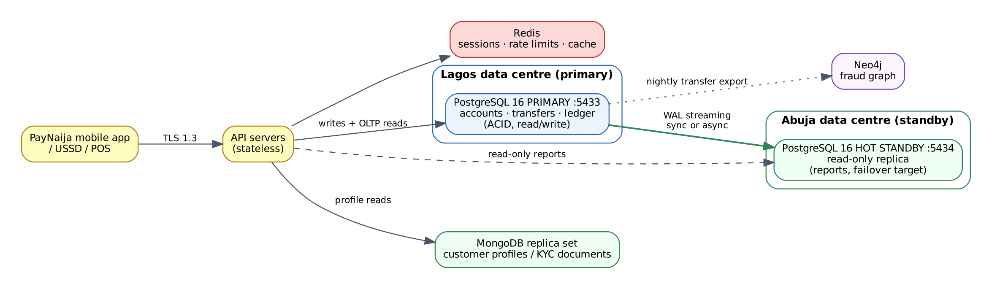
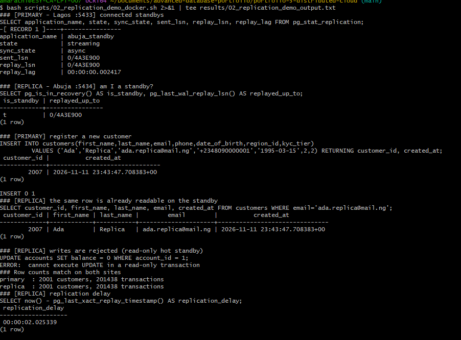
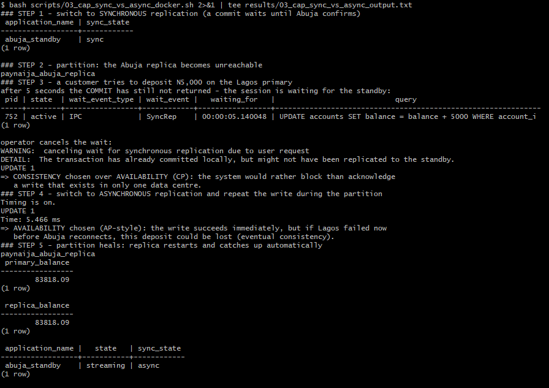
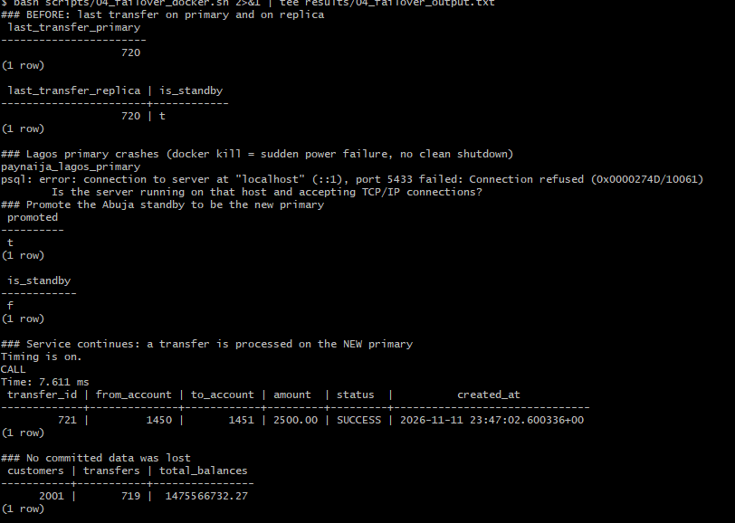
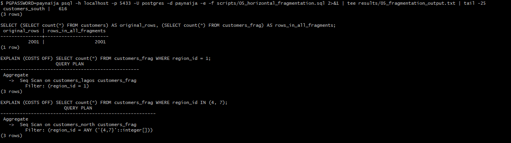

# Portfolio 5: Distributed and Cloud Database Exercise

**Case study:** PayNaija Wallet across two data centres, Lagos (primary) and Abuja (standby) · **DBMS:** PostgreSQL 16 streaming replication in Docker Desktop (Windows 11) · **Course link:** Study Session 2 (DDBS architecture, fragmentation, replication, consistency models, CAP, ACID vs BASE) and Session 3 (cloud databases)

## 1. Architecture



*Lagos runs the read/write primary; Abuja runs a hot standby that receives the write-ahead log (WAL) continuously. Reporting queries can be sent to the standby, which takes load off the primary.*

This is a **homogeneous** distributed database (same DBMS and OS at both sites) in a **primary–standby (client-server)** arrangement. It gives **replication transparency**: applications connect to "the database" and do not manage copies themselves.

## 2. Setting up replication (Docker Desktop on Windows 11)

The two sites run as two PostgreSQL 16 containers defined in [`docker/docker-compose.yml`](docker/docker-compose.yml):

| Container | Role | Host port |
|---|---|---|
| `paynaija_lagos_primary` | Read/write primary (`wal_level=replica`) | 5433 |
| `paynaija_abuja_replica` | Hot standby created with `pg_basebackup -R -X stream -C -S abuja_slot` | 5434 |

[`docker/init-primary.sh`](docker/init-primary.sh) creates a `replicator` role with the REPLICATION privilege and allows it in `pg_hba.conf`. The replica clones the primary, writes `standby.signal` + `primary_conninfo` (application_name `abuja_standby`), and uses a **replication slot**, so the primary keeps the WAL the replica still needs. My PayNaija database (Portfolios 1–4) was then loaded into Lagos with `pg_dump | psql`. Because the replica was already streaming, the whole load was replicated to Abuja automatically.

```bash
cd docker && docker compose up -d
pg_dump -d paynaija --no-owner --no-privileges | PGPASSWORD=paynaija psql -h localhost -p 5433 -U postgres -d paynaija
```

**Evidence** ([`scripts/02_replication_demo_docker.sh`](scripts/02_replication_demo_docker.sh) → [`results/02_replication_demo_output.txt`](results/02_replication_demo_output.txt)):
```
### [PRIMARY - Lagos :5433] connected standbys
application_name | abuja_standby
state            | streaming
sync_state       | async
sent_lsn         | 0/4A3E900
replay_lsn       | 0/4A3E900          <- standby has replayed everything sent
replay_lag       | 00:00:00.002417

### [REPLICA - Abuja :5434] am I a standby?
 is_standby | replayed_up_to
 t          | 0/4A3E900

### [PRIMARY] register a new customer       -> customer_id 2007 ('Ada', 'Replica')
### [REPLICA] the same row is already readable on the standby
 customer_id | first_name | last_name |        email
        2007 | Ada        | Replica   | ada.replica@mail.ng

### [REPLICA] writes are rejected (read-only hot standby)
ERROR:  cannot execute UPDATE in a read-only transaction

primary  : 2001 customers, 201438 transactions
replica  : 2001 customers, 201438 transactions
replication_delay  00:00:02.025339
```


The `replay_lag` of **2.4 ms** is the real replication delay. The final `replication_delay` (2 s) only measures the time since the *last* transaction was replayed: the script had been idle for about 2 seconds, so it is not lag.

## 3. Consistency vs availability: the CAP theorem in practice

[`scripts/03_cap_sync_vs_async_docker.sh`](scripts/03_cap_sync_vs_async_docker.sh). A **network partition** is simulated by stopping the Abuja container (`docker stop paynaija_abuja_replica`), and a customer then deposits ₦5,000 in Lagos.

**(a) Synchronous replication** (`synchronous_standby_names = 'abuja_standby'`): a commit returns only after Abuja confirms it has the data.
```
 application_name | sync_state
 abuja_standby    | sync
-- Abuja unreachable; customer deposits N5,000 --
after 5 seconds the COMMIT has still not returned - the session is waiting for the standby:
 pid | state  | wait_event_type | wait_event | waiting_for
 752 | active | IPC             | SyncRep    | 00:00:05.140048
operator cancels the wait:
WARNING:  canceling wait for synchronous replication due to user request
DETAIL:  The transaction has already committed locally, but might not have been replicated to the standby.
```
→ **CP behaviour:** during the partition the system stays **consistent** (no write is acknowledged unless it exists in both data centres) but loses **availability** (the customer's deposit hangs). The DETAIL line is an important subtlety: the cancelled transaction *was* committed in Lagos. Only the acknowledgement to the client was withheld, which is why production systems pair synchronous replication with a quorum of more than one standby.

**(b) Asynchronous replication** (`synchronous_standby_names = ''`), same partition:
```
UPDATE 1
Time: 5.466 ms
```
→ **AP-leaning behaviour:** the write succeeds immediately (**available**), but Abuja does not have it yet. If Lagos were destroyed at this moment, this deposit could be lost. Consistency is only **eventual**.

**(c) Partition heals:** `docker start` brings the replica back; it reconnects through its replication slot and catches up automatically.
```
 primary_balance 83818.09  |  replica_balance 83818.09  |  abuja_standby  streaming  async
```


## 4. High availability: failover

[`scripts/04_failover_docker.sh`](scripts/04_failover_docker.sh). The Lagos primary is killed with `docker kill` (SIGKILL, equivalent to a sudden power failure with no clean shutdown) and Abuja is promoted.
```
last_transfer_primary 720   |   last_transfer_replica 720, is_standby t
### Lagos primary crashes
psql: error: connection to server at "localhost" (::1), port 5433 failed: Connection refused
### Promote the Abuja standby
 promoted | t           is_standby | f
### Service continues on the NEW primary
CALL transfer_funds(1450, 1451, 2500);   -> CALL   Time: 7.611 ms
 transfer_id | from_account | to_account | amount  | status
         721 |         1450 |       1451 | 2500.00 | SUCCESS
### No committed data was lost
 customers 2001 | transfers 719 | total_balances 1475566732.27
```


Every transfer committed before the crash (up to id 720) exists on the new primary, so the **durability** of committed transactions survived the loss of a whole site. (There are 719 rows but the highest id is 720 because transfer id 1 was consumed by a constraint test in Portfolio 1 that was rejected. Sequences are never rolled back.) In my run the next id was 721 with no gap; PostgreSQL pre-logs sequence values in batches, so after some failovers a gap of a few ids can appear, which is also not data loss.

**What a real deployment adds:** promotion here was manual (`pg_promote()`). In production a failover manager (e.g. Patroni, or the cloud provider's Multi-AZ automation) detects the failure, promotes the standby and moves a virtual IP/DNS name so applications reconnect automatically. It also **fences** the old primary so it cannot come back as a second primary (*split brain*).

## 5. Horizontal fragmentation (sharding design)

[`scripts/05_horizontal_fragmentation.sql`](scripts/05_horizontal_fragmentation.sql) fragments `customers` by region using list partitioning (run on the Lagos primary):
```
    fragment     | count            original_rows | rows_in_all_fragments
 customers_lagos |   935                     2001 |                  2001   <- completeness
 customers_north |   450   (Abuja, Kano, Kaduna)
 customers_south |   616   (Rivers, Enugu, Oyo, Anambra)

EXPLAIN SELECT count(*) FROM customers_frag WHERE region_id = 1;
 Aggregate ->  Seq Scan on customers_lagos           <- only the Lagos fragment is read
EXPLAIN SELECT count(*) FROM customers_frag WHERE region_id IN (4, 7);
 Aggregate ->  Seq Scan on customers_north           <- only the North fragment is read
```


The fragments are **complete** (every row is in some fragment), **disjoint** (no row is in two), and **reconstructable** (the union equals the original). The planner's *partition pruning* gives **fragmentation transparency**: the query names `customers_frag` and never the fragment.

**Sharding plan for growth.** Here the fragments are on one server. At scale each fragment would sit on its own node (e.g. with the Citus extension or a NewSQL database such as CockroachDB):

| Option | Shard key | Pros | Cons |
|---|---|---|---|
| By region (list) | `region_id` | Data stays near users; supports NDPA in-country residency; easy to explain | **Lagos holds 47% of customers, creating a hot shard** |
| By hash | `hash(customer_id)` | Even spread across N shards | Regional reports must query every shard |
| **Chosen: hash on `customer_id`, with accounts and transactions co-located on the same shard** | | A customer's transfers between their own accounts stay single-shard; even load | Transfers between customers on different shards need a distributed transaction (**two-phase commit**), which adds latency |

## 6. Cloud deployment design

| Concern | Design for PayNaija on a managed cloud database (e.g. Amazon RDS for PostgreSQL / Azure Database for PostgreSQL) |
|---|---|
| Availability | Multi-AZ deployment: a synchronous standby in a second availability zone with automatic failover (the same mechanism tested in Sections 3–4, managed by the provider) |
| Read scaling | 1–2 asynchronous read replicas for statements and reports |
| Backup / DR | Automated daily snapshots + point-in-time recovery from WAL; cross-region snapshot copy |
| Security | Encryption at rest (AES-256, KMS-managed keys), TLS in transit, private subnet with no public IP, IAM/RBAC, audit logging (Session 3 & 6) |
| Compliance | NDPA 2023 requires safeguards for cross-border transfer of Nigerians' personal data, so the primary would be placed in an in-country or approved region, with a DPIA before migration |
| Cost model | Pay-as-you-go; scale compute up for month-end peaks; serverless options for dev/test |

## 7. Analysis: which consistency model for which data?

| PayNaija data | Requirement | Choice |
|---|---|---|
| Balances, transfers, ledger | Must never be lost or diverge | **ACID + synchronous replication (CP)**: a brief outage is better than wrong money |
| Statements, reports on replicas | Can be a second behind | Asynchronous replicas (read-your-writes is not guaranteed on a replica, so a customer's own new transfer is read from the primary) |
| Notifications, leaderboards, recommendations | Availability first | **BASE / eventual consistency (AP)** in Redis/MongoDB |

PostgreSQL's single-primary design is a CP-leaning system. The experiment showed that the CAP trade-off is not fixed by the product: it was **configured** with one setting (`synchronous_standby_names`), and both behaviours were observed on the same database.

## How to run (Windows, Docker Desktop, UCRT64 terminal)
```bash
cd docker && docker compose up -d && cd ..
pg_dump -d paynaija --no-owner --no-privileges > dump.sql
PGPASSWORD=paynaija psql -h localhost -p 5433 -U postgres -d paynaija -q -f dump.sql && rm dump.sql
bash scripts/02_replication_demo_docker.sh
PGPASSWORD=paynaija psql -h localhost -p 5433 -U postgres -d paynaija -e -f scripts/05_horizontal_fragmentation.sql
bash scripts/03_cap_sync_vs_async_docker.sh
bash scripts/04_failover_docker.sh          # run last: it kills the primary
# reset everything: cd docker && docker compose down -v
```
`scripts/01_setup_replica.sh`, `02_replication_demo.sh`, `03_cap_sync_vs_async.sh` and `04_failover.sh` are the equivalent native-Linux versions of the same exercise.
